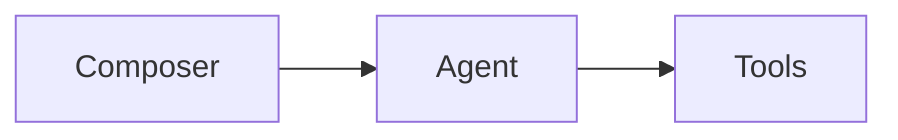

Answers are rendered as GitHub-flavored Markdown. Formatting arrives as the text streams, so
a table or a code block may look incomplete for a moment before it closes.

## Supported syntax

| Feature | Example |
| --- | --- |
| Headings, lists, bold, italic, strikethrough | Standard Markdown |
| Tables | Pipe tables, scrollable when wide |
| Task lists | `- [x] done` |
| Footnotes | `[^1]` with a **Notes** section at the end |
| Autolinks | Bare URLs become links |
| GitHub alerts | `> [!NOTE]`, `[!TIP]`, `[!IMPORTANT]`, `[!WARNING]`, `[!CAUTION]` |
| Inline HTML | A safe subset: `<mark>`, `<kbd>`, `<sup>`, `<sub>`, `<details>` |
| Math | `$inline$` and `$$block$$` via KaTeX |
| Diagrams | ` ```mermaid ` blocks |
| Code | Fenced blocks with language highlighting and **Copy code** |

## Math

Inline math uses single dollars, block math double dollars:

```markdown
The growth rate is $r = \frac{V_f - V_i}{V_i}$.

$$
P(A \mid B) = \frac{P(B \mid A)\,P(A)}{P(B)}
$$
```

KaTeX renders locally; no external service is involved.

## Diagrams

````markdown

````

Mermaid runs with `securityLevel: strict`: click handlers and scripts inside a diagram are
disabled. Unsupported syntax shows the diagram source instead of failing the message.

## Code

Fenced blocks are highlighted for 30+ languages and get a **Copy code** button. Long lines
scroll horizontally inside the block; the rest of the message keeps its width.

## HTML, SVG and charts

Three extra fences get a preview:

| Fence | Result |
| --- | --- |
| `html` | Rendered in a sandboxed iframe (no scripts, no access to the app) |
| `svg` | Rendered inline, sanitized |
| `chart` | JSON data rendered as an SVG chart |

Use them when you asked for a small page, an icon or a quick plot and want to see it without
saving a file. For anything you need to keep, ask for an artifact instead — see
[Artifacts](/docs/artifacts).

## Security

Raw HTML in an answer goes through an allowlist: scripts, iframes, event handlers and style
blocks are removed, `srcset` is dropped, and links are opened in your default browser rather
than inside the app. Images load lazily.

This applies to everything the model writes, including content copied from a web page it
read. Treat formatted output as a rendering of untrusted text, not as a trusted document.

## Tips

- Ask for a table when you compare three or more things; it stays readable in the transcript.
- Ask for a Mermaid diagram when explaining a flow; it is easier to check than prose.
- If math looks wrong, check the delimiters: `$...$` must not contain a blank line.
- Copying a block with **Copy code** preserves indentation; selecting with the mouse does not
  always.

Next: [Code execution](/docs/code-execution).
